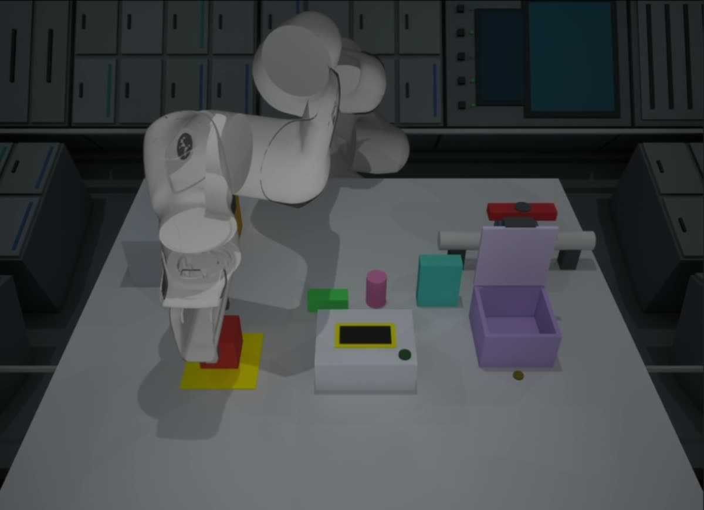

# Talking to a robot arm in a space station

You type something like *"shut off the coolant"*, and a Franka Panda arm in a space-station lab I built in
**Unreal Engine 5.8** reaches over and closes the valve.



Two models share the work:

- **Llama 3 8B** reads what you typed and works out which of the five jobs you mean, or politely refuses.
- **OpenVLA-7B** looks at one camera image at a time and decides how the arm should move next. I fine-tuned it on
  demonstrations recorded in this scene.

The models run on a GPU server, and the simulation runs on a MacBook. They talk over an SSH tunnel, about once a second.

This was my first robot-learning project, so the README also covers what broke along the way and how I fixed it.

---

## What it can do

| # | You might type | What the robot does |
|---|---|---|
| 1 | "move the red block onto the yellow pad" | picks up the red cube and places it on the yellow marker |
| 2 | "stow the wrench and shut the drawer" | opens the drawer, puts the tool inside, closes it |
| 3 | "shut off the coolant" | turns the coolant valve lever 90° |
| 4 | "swap in the new filter" | slides the filter cartridge into the air scrubber |
| 5 | "store the specimen tube in the container and close it" | puts the sample vial in the box and latches the lid |

Any wording works. Typos and paraphrases are fine, and requests that aren't one of these jobs get a polite "I can't do that".

## How it works

```
  "shut off the coolant"
          │
          ▼
  Llama 3 ── "that's task 3" ──► Unreal swaps in the sentence OpenVLA was trained on:
                                  "Close the coolant valve."
          ┌───────────────────────────────┘
          ▼            repeats every ~1 s until the task is done
  Unreal camera frame + sentence
          │
          ▼
  gateway (Mac) ── PNG ──► OpenVLA on the GPU ──► 7 numbers: move the hand by
          │                                        [dx dy dz droll dpitch dyaw] + open/close
          ▼
  inverse kinematics ──► 7 joint angles ──► the arm moves (smoothly), Unreal checks "done?"
```

Why two models? OpenVLA is good at *seeing and moving*, but it only really understands the exact sentences it was
trained on. Llama is good at *language*. So Llama turns whatever you type into one of the known tasks, and OpenVLA never
sees free-form text.

Tasks 2 and 5 are split into sub-steps ("Open the drawer." → "Put the tool in the drawer." → "Close the drawer.").
That's because a closed drawer looks the same at the start and the end of the task, and the model couldn't tell which
one it was in.

## How I trained it

- **Teacher demos.** I wrote a scripted expert for each task and recorded **1,000 successful runs** (200 per task) in
  Unreal. That took about 15 hours. While recording I added small random nudges (DART noise), so the model also sees
  how to recover from mistakes.
- **Dataset.** Every 3rd frame gives **67,900 image + action pairs** from 950 episodes. The other 50 episodes are held
  out for testing.
- **Fine-tuning.** LoRA (rank 32) on every linear layer of OpenVLA-7B: **110.8 M trainable parameters**, about 1.5 % of
  the model. The base was loaded in 4-bit (QLoRA), so training fits on one RTX A6000.

| Run | What it learned | Steps | Time | Used for |
|---|---|---|---|---|
| `side_v12` | task 1 in an earlier MuJoCo version of the lab | 2,500 | — | starting point |
| `t1_lr5e-4` | task 1 in Unreal | 2,500 | — | starting point |
| `bench_9k` | all 5 tasks | 9,000 | ≈ 7.5 h | **task 1** (checkpoint 7,000) |
| `bench_sub` | all 5 tasks, sub-step sentences | 3,500 | ≈ 3.7 h | **tasks 2–5** |

## How well it works

**Live in Unreal, with OpenVLA driving: 5 out of 5 tasks completed.** These are single runs on the fixed layout.

| Task | 1 | 2 | 3 | 4 | 5 |
|---|---|---|---|---|---|
| Steps to finish | 90 | 228 | 83 | 91 | 137 |

**Against the expert on held-out frames** (320 frames the model never trained on):

| How the model is served | Hand-move error | Direction match | Gripper agrees | Time per step |
|---|---|---|---|---|
| 4-bit | 0.24 mm | 0.984 | 99.1 % | 0.97 s |
| **bf16 (what I use)** | 0.29 mm | 0.973 | 99.4 % | 0.55 s |
| bf16, LoRA merged | 0.29 mm | 0.976 | 99.1 % | 0.38 s |

The merged version is the fastest on paper, but live it froze after grabbing the filter in task 4. So I went with
bf16 and an unmerged LoRA.

**Llama 3** picked the right task for **32 of 35** test requests (91 %). That's 5/5 plain requests, 15/15 paraphrases,
6/6 correct refusals, 4/5 with typos and 2/4 genuinely ambiguous ones. Each request takes about 1.1 s.

### Things that broke along the way

- **Task 2 never finished.** The arm opened the drawer and then just hovered, because "hand above a closed drawer" is
  both the start and the end of the task. Sub-step sentences fixed it.
- **The sub-step model put the cube back on the table** in task 1. Task 1 now uses its own checkpoint (step 7,000).
- **The gripper kept opening and closing.** A grasped object hung 4 cm below the hand and confused the model. Snapping
  grasped objects to the centre of the grasp fixed it.
- **The arm stalled in task 5** with its elbow at a joint limit. A gentle pull towards the home posture in the IK
  solved it, and the fix passed 300 out of 300 checks.
- **The motion was jerky** at one action per second. Now the next action is fetched while the arm is still moving, and
  each move is eased in.

## What you need

| | |
|---|---|
| Simulator | Unreal Engine 5.8. I used a MacBook Air M5 with 24 GB; no CUDA needed. |
| Model server | One CUDA GPU with about 24 GB free (OpenVLA in bf16 + Llama in 4-bit). I used an RTX A6000 on a shared PBS cluster. |
| Speed | 0.6–1.1 s per step, so a task takes about 1.5–4 minutes. |

## Run it yourself

**1. Get the weights.** They're stored with Git LFS (443 MB per adapter):

```bash
git lfs install
git clone https://github.com/ImUrvashi/bas-lab-openvla-panda.git
```

| Folder | Used for |
|---|---|
| `weights/bench_sub_step3500/` | tasks 2–5 |
| `weights/bench_9k_step7000/` | task 1 |
| `weights/side_v12_step2500/` | the original MuJoCo lab model |

**2. Start the model server** on any machine with a suitable GPU. Run it from a checkout of the
[OpenVLA repo](https://github.com/openvla/openvla), with this repo's scripts copied into `panda_tests/`. Llama 3 is
gated, so request access on Hugging Face and log in first:

```bash
python panda_tests/policy_server.py --bf16 --port 8001 \
    --adapter_dir weights/bench_sub_step3500/lora_adapter \
    --route "pick up the red cube=weights/bench_9k_step7000/lora_adapter" \
    --llm meta-llama/Meta-Llama-3-8B-Instruct
```

On my cluster, `./server/start_demo_server.sh` does this through PBS. It reads the login from `server/login.env`
(not committed), which holds `MASTER=<user>@<master>` and `COMPUTE=<user>@compute`.

**3. Connect the Mac to the server and start the gateway:**

```bash
ssh -N -L 8001:127.0.0.1:8001 -J <user>@<master> <user>@compute     # tunnel
.venv/bin/python policy_ik_gateway.py --upstream-url http://127.0.0.1:8001/act --speed 2.5 --fine-speed 1.5
```

**4. Play.** Open `unreal/BASPanda/BASPanda.uproject`, press **Play** and type a request into the box at the bottom.
Useful switches on the policy bridge actor:

- **Use Model:** OpenVLA. Turn it off to watch the scripted expert instead.
- **Smooth Motion:** fetches the next action while the arm is still moving.
- **Randomize Layout:** shifts objects by up to ±1 cm each run, which is the range the model was trained on.

Add `--trace doc/trace.csv` to the gateway to log every step. There's also a scripted fallback that still uses Llama:
`policy_ik_gateway.py --policy expert --port 8002 --llm-url http://127.0.0.1:8001/interpret`.

## What's in here

| Path | What it is |
|---|---|
| `unreal/BASPanda/Source/BASPanda/` | the Unreal side: Panda arm, workbench and tasks, camera, model bridge, command box |
| `policy_ik_gateway.py` | the bridge between Unreal and the model: images, IK, speed and smoothing, scripted experts, recording |
| `policy_server.py`, `llm_frontend.py` | the GPU server: OpenVLA `/act` and Llama 3 `/interpret` |
| `multitask_expert.py`, `expert_policy.py` | the scripted teachers |
| `build_unreal_export.py`, `finetune_panda.py`, `eval_checkpoints.py` | dataset export, training, offline evaluation |
| `openvla_adapter.py` | Panda kinematics and action encoding |
| `server/` | PBS job scripts for training, serving and evaluation |
| `bas_lab/`, `closed_loop_panda.py` | the original MuJoCo version of the lab |

## Honest limitations

- **It only knows this one room.** It has one scene and one camera angle, and objects stay within about 1 cm of where
  they were in training. Move things further, or add new objects, and it needs new demos.
- **The physics is simplified.** Grasped objects snap to the gripper, and the drawer, valve and lid move on rails. Gravity
  is off, which is fair enough on a space station.
- **It's slow.** It runs about 1 action a second, while the scripted expert does 10. Predicting several actions at once
  (OpenVLA-OFT) and running the GPU next to the simulator would be the next steps.

## Where it started

The first version was a MuJoCo model of the same lab, with task 1 only and gravity off. It's in `bas_lab/` and runs with
`closed_loop_panda.py`. Its best model placed the cube in 12/12 held-out layouts and 12/12 fresh ones, and it became the
starting point for the Unreal training. The Panda model comes from MuJoCo Menagerie (Apache-2.0).
